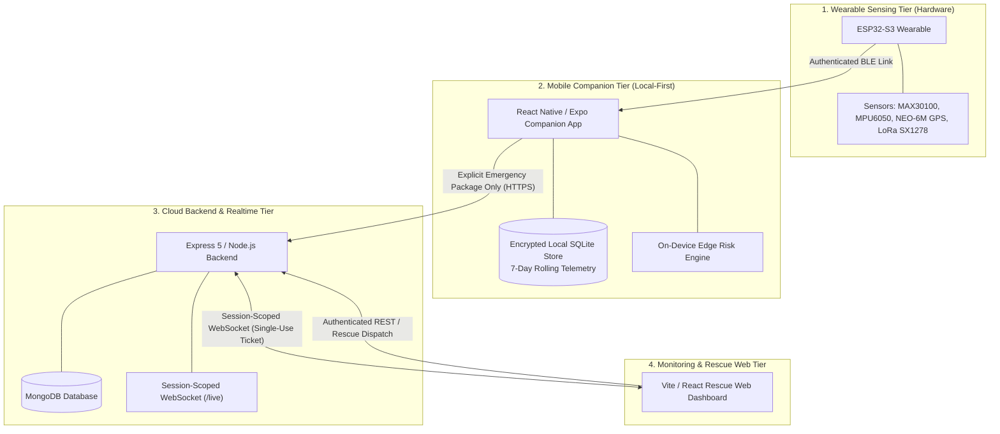

# SWAAS / TrailGuard — Unified AI Agent Directives & Architecture

**Project:** SWAAS (Smart Wearable Assistance & Alert System) / TrailGuard  
**Audience:** All Autonomous AI Agents (Google Antigravity, GitHub Copilot, SWE-agent, Claude Code, Cursor) & Human Developers  
**Policy:** Single Source of Truth — Zero-Tolerance Safety, Privacy & Architectural Invariants  
**Companion Audit:** [Security Audit Assessment](SECURITY_AUDIT.md)

---

## 1. System Mission & 4-Tier Architecture

SWAAS / TrailGuard is a safety-critical smart wearable ecosystem designed for hikers, lone workers, and vulnerable individuals. It operates across four tightly decoupled tiers:

---

## 2. Naming Conventions & Code Style Standards

All agents must strictly adhere to the following naming conventions across every tier:

| Artifact                   | Convention                            | Examples                                                          |
| :------------------------- | :------------------------------------ | :---------------------------------------------------------------- |
| **React Components**       | `PascalCase`                          | `StatCard.jsx`, `LineTrace.jsx`, `GaugeBar.jsx`, `MiniStats.jsx`  |
| **Custom React Hooks**     | `camelCase` (prefixed with `use`)     | `useUpdatedTime.js`, `useDashboardData.js`, `useHistoryData.js`   |
| **Controllers & Services** | `camelCase` (with descriptive suffix) | `deviceRegistrationController.js`, `devicePairingService.js`      |
| **Routes**                 | `camelCase` (with `Routes` suffix)    | `deviceRegistrationRoutes.js`, `emergencyRoutes.js`               |
| **Utility Functions**      | `camelCase`                           | `formatUpdatedText()`, `calculateRiskScore()`, `sanitizeLog()`    |
| **Constants & Enums**      | `UPPER_SNAKE_CASE`                    | `AUDIT_FAILURE`, `MAX_HISTORICAL_POINTS`, `WS_TICKET_TTL_SECONDS` |
| **Error Classes**          | `PascalCase` (ending in `Error`)      | `AppError` (backend), `ApiError` (frontend/mobile)                |
| **Environment Variables**  | `UPPER_SNAKE_CASE`                    | `JWT_SECRET`, `VITE_API_URL`, `EXPO_PUBLIC_API_URL`               |

---

## 3. The 6 Specialized AI Agent Personas

Work across this repository is partitioned among 6 specialized personas. Every agent invocation must identify its persona and respect file ownership and verification boundaries:

### 🛡️ Agent 1: Security & Cryptography Specialist

- **Scope:** Cross-tier cryptography, Ed25519 device signatures, fail-closed audit logs, role-based access control.
- **Owned Files:** `backend/middleware/deviceAuthMiddleware.js`, `backend/middleware/authMiddleware.js`, `backend/models/DeviceAuthNonce.js`, `backend/models/AuditLog.js`, `backend/services/deviceAuthorizationReceiptService.js`, `backend/utils/logger.js`, `SECURITY.md`, `SECURITY_AUDIT.md`.
- **Forbidden Files:** Frontend/Mobile UI code (`frontend/src/components/*`, `mobile/src/screens/*`), sensor drivers.
- **Verification Gate:** `cd backend && ./node_modules/.bin/jest tests/securityHardening.test.js tests/deviceAuth.test.js`

### ☁️ Agent 2: Cloud Backend & Realtime Architect

- **Scope:** Express 5 REST APIs, session-scoped WebSockets, ephemeral TTL collections, rate limiting, and database models.
- **Owned Files:** `backend/server.js`, `backend/app.js`, `backend/routes/*`, `backend/controllers/*`, `backend/services/*`, `backend/realtime/*`, `backend/models/*`, `backend/config/*`.
- **Forbidden Files:** Firmware C code, mobile UI presentation.
- **Verification Gate:** `cd backend && ./node_modules/.bin/jest tests/securityHardening.test.js tests/socketManager.test.js tests/emergencyModels.test.js tests/webSocketTicketService.test.js`

### 📱 Agent 3: Mobile & Edge Risk Engine Specialist

- **Scope:** React Native / Expo 57 companion app, local SQLite rolling 7-day telemetry buffer, on-device risk engine.
- **Owned Files:** `mobile/src/*`, `mobile/scripts/*`.
- **Forbidden Files:** Backend server routes, firmware memory maps, web dashboard styles.
- **Verification Gate:** `cd mobile && node scripts/check-syntax.js`

### ⚡ Agent 4: Hardware & Firmware Engineer

- **Scope:** ESP32-S3 FreeRTOS/C, NimBLE Bluetooth stack, sensor drivers (MAX30100, MPU6050, GPS, LoRa), Flash Encryption & Secure Boot.
- **Owned Files:** `hardware/*`.
- **Forbidden Files:** Cloud Node.js backend, React frontend components, mobile application screens.
- **Verification Gate:** Firmware: with ESP-IDF 5.3+ configured for ESP32-S3, run `cd hardware/firmware && idf.py set-target esp32s3 && idf.py build`. Python drivers only: `python3 -m compileall -q hardware` from the repository root.

### 🖥️ Agent 5: Rescue Web & Frontend Specialist

- **Scope:** React 19 / Vite rescue monitoring dashboard, MapLibre GL mapping, SVG telemetry charts, single-use WebSocket ticket consumption.
- **Owned Files:** `frontend/src/*`, `frontend/vite.config.js`.
- **Forbidden Files:** Hardware firmware, backend cryptographic authorization logic.
- **Verification Gate:** `cd frontend && ./node_modules/.bin/vitest run && ./node_modules/.bin/vite build`

### 🧪 Agent 6: QA, Verification & CI/CD Sentinel

- **Scope:** GitHub Actions pipelines, multi-tier automated regression suites, static analysis, syntax and security linters.
- **Owned Files:** `.github/workflows/*`, `backend/tests/*`, `frontend/test/*`.
- **Forbidden Files:** Direct modification of core business logic or crypto keys without audit approval.
- **Verification Gate:** Execute all 4 tier test suites with 0 failures before any merge.

---

## 4. Mandatory Architectural Invariants (Zero-Tolerance Rules)

Every agent MUST uphold the following 7 invariants. **A client-side check is never an authorization control.**

### Invariant 1: Local-First Privacy (No Continuous Cloud Telemetry)

- **Target architecture:** Continuous vitals and location data (heart rate, SpO2, GPS coordinates, accelerometer/gyroscope samples, temperature, pressure) should stay **local** to the mobile device in a rolling 7-day SQLite buffer. This is not enforced by the current mobile storage path: `HistoryScreen` uses `useHistoryData`, which fetches cloud history APIs; an encrypted local telemetry buffer is not yet implemented.
- **Strict Prohibition:** Never implement automatic cloud streaming of normal background health telemetry. The backend is an incident coordinator, NOT a continuous cloud health data lake.

### Invariant 2: Emergency-Bounded Cloud Sharing

- **Target architecture:** Telemetry should leave the user app and enter the cloud backend only during an authorized emergency session (SOS button or uncancelled fall countdown). This is not an enforced current guarantee: prototype/simulator telemetry uploads and mobile cloud history access still exist.
- **Strict Bound:** Cloud sharing is strictly bounded to the active incident plus at most the preceding **6 hours**.
- **Query Cap:** Historical replay queries are capped at a maximum of 100 readings per sensor type.

### Invariant 3: Fail-Closed Security Audit Logging

- All access to protected health and location data (`GET /api/emergency/sessions/:sessionId/historical`) must write an immutable entry to `AuditLog` **before** reading from the database.
- **Enforcement:** If writing the audit record fails for any reason (database timeout, replica failover), the operation must immediately throw `AUDIT_FAILURE` (HTTP 500) and return zero health data. Fail-open behavior is strictly prohibited.

### Invariant 4: Cryptographic Device Authentication

- Hardware devices prove identity via pre-provisioned Ed25519 asymmetric signatures.
- **Required Headers:** `X-Device-ID`, `X-Device-Timestamp`, `X-Device-Nonce`, `X-Device-Signature`.
- **Verification:** The backend computes a SHA-256 digest of the raw request body and verifies the canonical signature against `Device.publicKey`.
- **Replay Protection:** Nonces are stored in `DeviceAuthNonce` with a compound unique index and TTL; request timestamps must fall strictly within a ±5-minute skew window.
- **Prohibition:** Never trust `deviceId` or `userId` in JSON payloads. Never allow ID-only device claiming.

### Invariant 5: Ephemeral Retention & Automated TTL Cleanup

- All emergency sessions and WebSocket authentication tickets are ephemeral:
  - `WebSocketTicket`: Single-use, expires in 60 seconds via MongoDB TTL index (`expireAfterSeconds: 0`), atomically consumed via `findOneAndUpdate`.
  - `EmergencySession`: `expiresAt` is set to 48 hours after creation, independent of resolution or status expiration. Records become eligible for automatic purge at that time via the MongoDB TTL index; deletion occurs on a subsequent TTL sweep.

### Invariant 6: Authenticated, Session-Scoped Real-Time Delivery

- Legacy global WebSocket broadcasts (`clients = new Set()`) are strictly prohibited for telemetry and emergency data.
- **Scoped Routing:**
  - Device telemetry is delivered strictly to the authenticated device owner (`userId`).
  - Live emergency updates (GPS coordinates, vitals summary, risk scores) are delivered strictly to clients with verified subscriptions to that specific `sessionId`.
  - General feed subscribers only receive new session alerts (`emergency_session_created`).

### Invariant 7: Structured Redacted Logging

- Sensitive fields must never appear in application logs.
- **Redacted Fields:** Passwords, JWTs, refresh tokens, pairing challenge nonces, digital signatures, GPS coordinates (`latitude`, `longitude`), vitals (`heartRate`, `spo2`), and phone numbers.
- **Implementation:** Always use `backend/utils/logger.js`. In production, logs are emitted as single-line JSON.

---

## 5. Role-Based Access Control (RBAC) Matrix

| Endpoint / Capability                                |    Citizen     |    Responder     | Coordinator |   Admin    | Notes                                              |
| :--------------------------------------------------- | :------------: | :--------------: | :---------: | :--------: | :------------------------------------------------- |
| `POST /api/emergency/ws-ticket`                      |       ✅       |        ✅        |     ✅      |     ✅     | Single-use 60s ticket for WebSocket upgrade        |
| `POST /api/emergency/sessions`                       |       ✅       |        ❌        |     ❌      |     ✅     | Citizens initiate for own paired devices           |
| `GET /api/emergency/sessions/active`                 |    Own only    |     Assigned     |     All     |    All     | Scoped by role in `emergencySessionService`        |
| `GET /api/emergency/sessions/:sessionId`             |     Owner      |     Assigned     |     All     |    All     | Audited access                                     |
| `PATCH /api/emergency/sessions/:sessionId/status`    | Cancel/Resolve | Escalate/Resolve |     All     |    All     | Only owner/admin can cancel; rescue staff escalate |
| `POST /api/emergency/sessions/:sessionId/location`   |     Owner      |        ❌        |    Admin    |   Admin    | Live GPS updates during active emergency           |
| `POST /api/emergency/sessions/:sessionId/responders` |       ❌       |    Self-join     | Assign any  | Assign any | Assigned user must have `responder` or rescue role |
| `GET /api/emergency/sessions/:sessionId/historical`  |       ❌       |     Assigned     |     All     |    All     | Strict 6h window; fail-closed audit                |
| `GET /api/emergency/sessions/:sessionId/audit`       |       ❌       |        ❌        |     ✅      |     ✅     | Requires `emergency:audit:read`                    |

---

## 6. Prohibited Anti-Patterns (Anti-Hallucination Directives)

1. **NEVER accept raw tokens in WebSocket URL queries:** Do not use `/live?token=...`; query strings leak into access logs. Always use `POST /api/emergency/ws-ticket` to obtain a single-use ticket and send it in the WebSocket subprotocol header (`trailguard, ticket.<ticket>`). Fail closed if ticket acquisition fails; never fall back to URL credentials. The backend must not accept credentials in query parameters.
2. **NEVER swallow audit log errors:** Catching an audit write error without re-throwing causes a fail-open security hole. Always throw `AUDIT_FAILURE` (HTTP 500).
3. **NEVER trust client-provided IDs without ownership validation:** Always verify `Device.userId === req.userId` in the database.
4. **NEVER expose MongoDB internal `_id` in public session routes:** Always use the opaque UUID `sessionId`.
5. **NEVER remove or bypass rate limiters on public endpoints:** Ensure `authLimiter`, `deviceLimiter`, and `telemetryLimiter` remain intact.
6. **NEVER commit plain-text credentials or API secrets:** All secrets must be loaded from validated environment configurations via `config/env.js`.
7. **NEVER invent new database schemas or remove TTL indexes:** All emergency data must expire automatically.
