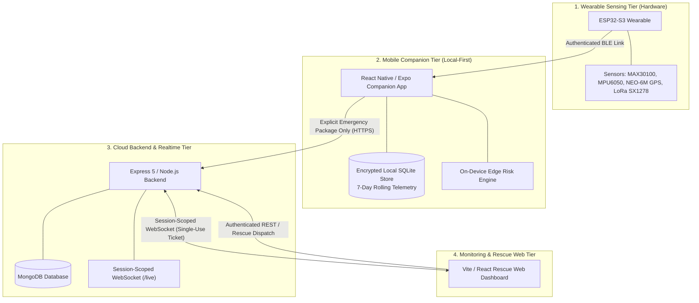

# AI Agent Guidelines & Architectural Directives

**Project:** SWAAS (Smart Wearable Assistance & Alert System) / TrailGuard  
**Audience:** All Autonomous AI Coding Agents (Google Antigravity, GitHub Copilot, SWE-agent, Claude Code, Cursor, etc.)  
**Repository Policy:** Strict Enforcement of Safety, Privacy, and Architectural Invariants  

---

## 1. System Mission & Ecosystem Architecture

SWAAS / TrailGuard is a safety-critical smart wearable ecosystem designed for hikers, lone workers, and vulnerable individuals. It consists of four integrated tiers:



---

## 2. Mandatory Architectural Invariants (Zero-Tolerance Rules)

Every AI agent working on this repository MUST strictly preserve and enforce the following invariants. **A client-side check is never an authorization control.**

### Invariant 1: Local-First Privacy (No Continuous Cloud Telemetry)
* **Rule:** Continuous health and location telemetry (heart rate, SpO2, GPS coordinates, accelerometer/gyroscope motion samples, temperature, barometric pressure) is strictly stored **locally** on the user's mobile device in a rolling 7-day buffer.
* **Prohibition:** Agents must NEVER implement background sync or continuous cloud telemetry upload in normal operation. The backend is an incident coordinator, NOT a continuous cloud health data lake.

### Invariant 2: Emergency-Bounded Cloud Sharing
* **Rule:** Sensor data leaves the user app and enters the cloud backend ONLY when an authorized emergency session is active (via manual SOS button or uncancelled fall timer countdown).
* **Bound:** Cloud sharing is strictly bounded to the emergency incident plus at most the preceding **6 hours**.
* **Cap:** Historical replay queries are capped at a maximum of 100 readings per sensor type.

### Invariant 3: Fail-Closed Security Audit Logging
* **Rule:** All access to protected health and location data (specifically `GET /api/emergency/sessions/:sessionId/historical`) must write an immutable audit entry to `AuditLog` **before** reading from the database.
* **Enforcement:** If writing the audit record fails for any reason (e.g., database timeout or primary failover), the operation must immediately throw `AUDIT_FAILURE` (HTTP 500) and return zero health data. Fail-open behavior is strictly prohibited.

### Invariant 4: Cryptographic Device Authentication
* **Rule:** Hardware devices prove identity via pre-provisioned Ed25519 asymmetric cryptographic signatures.
* **Headers Required:** `X-Device-ID`, `X-Device-Timestamp`, `X-Device-Nonce`, `X-Device-Signature`.
* **Verification:** The backend computes a SHA-256 digest of the raw request body and verifies the canonical signature against the provisioned `Device.publicKey`.
* **Replay Protection:** Nonces are stored in `DeviceAuthNonce` with a compound unique index and TTL; request timestamps must fall strictly within a ±5-minute skew window.
* **Prohibition:** Never trust `deviceId` or `userId` in JSON payloads. Never allow ID-only device claiming.

### Invariant 5: Ephemeral Retention & Automated TTL Cleanup
* **Rule:** All emergency sessions and WebSocket authentication tickets are ephemeral:
  * `WebSocketTicket`: Single-use, expires in 60 seconds via MongoDB TTL index (`expireAfterSeconds: 0`), atomically consumed via `findOneAndUpdate`.
  * `EmergencySession`: Automatically purged 48 hours after resolution/expiration via MongoDB TTL index on `expiresAt`.

### Invariant 6: Authenticated, Session-Scoped Real-Time Delivery
* **Rule:** Legacy global WebSocket broadcasts (`clients = new Set()`) are strictly prohibited for telemetry and emergency data.
* **Scoped Routing:**
  * Device telemetry is delivered strictly to the authenticated device owner (`userId`).
  * Live emergency updates (GPS coordinates, vitals summary, risk scores) are delivered strictly to clients with verified subscriptions to that specific `sessionId`.
  * General feed subscribers (`subscribedToEmergencyFeed`) only receive new session alerts (`emergency_session_created`).

### Invariant 7: Structured Redacted Logging
* **Rule:** Sensitive fields must never appear in application logs.
* **Redacted Fields:** Passwords, JWTs, refresh tokens, pairing challenge nonces, digital signatures, GPS coordinates (`latitude`, `longitude`), vitals (`heartRate`, `spo2`), and phone numbers.
* **Implementation:** Always use `backend/utils/logger.js`. In production, logs are emitted as single-line JSON.

---

## 3. Role-Based Access Control (RBAC) Matrix

| Endpoint / Capability | Citizen | Responder | Coordinator | Admin | Notes |
| :--- | :---: | :---: | :---: | :---: | :--- |
| `POST /api/emergency/ws-ticket` | ✅ | ✅ | ✅ | ✅ | Single-use 60s ticket for WebSocket upgrade |
| `POST /api/emergency/sessions` | ✅ | ❌ | ✅ | ✅ | Citizens initiate for own paired devices |
| `GET /api/emergency/sessions/active` | Own only | Assigned | All | All | Scoped by role in `emergencySessionService` |
| `GET /api/emergency/sessions/:sessionId` | Owner | Assigned | All | All | Audited access |
| `PATCH /api/emergency/sessions/:sessionId/status` | Cancel/Resolve | Escalate/Resolve | All | All | Only owner/admin can cancel; rescue staff escalate |
| `POST /api/emergency/sessions/:sessionId/location` | Owner | ❌ | Admin | Admin | Live GPS updates during active emergency |
| `POST /api/emergency/sessions/:sessionId/responders` | ❌ | Self-join | Assign any | Assign any | Assigned user must have `responder` or rescue role |
| `GET /api/emergency/sessions/:sessionId/historical` | ❌ | Assigned | All | All | Strict 6h window; fail-closed audit |
| `GET /api/emergency/sessions/:sessionId/audit` | ❌ | ❌ | ✅ | ✅ | Requires `emergency:audit:read` |

---

## 4. Multi-Agent Development & Git Workflow

To prevent conflicts and regressions when multiple AI agents work on the codebase:

### Branch Naming Conventions
- `day-X-<feature-slug>`: Major milestone branches (e.g., `day-5-websocket-emergency-communication`).
- `feat/<feature-name>`: Discrete new capabilities.
- `fix/<bug-description>`: Bug fixes and security hardening.
- `docs/<doc-subject>`: Documentation updates.

### Commit Standards
Follow Conventional Commits:
```bash
feat(backend): implement fail-closed audit logging on emergency historical access
fix(security): enforce responder role validation during incident assignment
docs(architecture): add Day 6 privacy and security specification
test(realtime): add unit tests for session-scoped WebSocket ticket consumption
```

### Pull Request Rules
- Always fill out `.github/pull_request_template.md`.
- Include affected tiers, invariants checked, and test verification output.

---

## 5. Verification Commands

Before proposing, committing, or merging changes, every AI agent must execute and pass the appropriate verification suite:

### Backend Testing (Node.js / Express / Jest)
```bash
cd backend
# Run all unit and integration test suites in-band
./node_modules/.bin/jest --runInBand

# Run specific test suite
./node_modules/.bin/jest tests/securityHardening.test.js
./node_modules/.bin/jest tests/emergencySessionApi.test.js
./node_modules/.bin/jest tests/socketManager.test.js
```
*Note:* All 10 backend test suites (`server`, `auth`, `deviceAuth`, `deviceProvisioning`, `emergencyModels`, `emergencySessionApi`, `rateLimiter`, `socketManager`, `webSocketTicketService`, `securityHardening`) must pass with 0 failures.

### Frontend Testing & Build (React 19 / Vite / Vitest)
```bash
cd frontend
# Run vitest suite (23 tests)
./node_modules/.bin/vitest run

# Run production Vite build
./node_modules/.bin/vite build
```

### Mobile App Syntax Verification (React Native / Expo 57)
```bash
cd mobile
# Validate syntax across all 27 mobile JavaScript files
node scripts/check-syntax.js
```

---

## 6. Prohibited Anti-Patterns (Agent Don'ts)

1. **NEVER accept raw tokens in WebSocket URL queries in production:** Do not use `/live?token=eyJ...` as a substitute for single-use tickets; URLs are recorded in web server and proxy access logs.
2. **NEVER swallow audit log errors on sensitive data routes:** Swallowing errors produces a fail-open security bypass.
3. **NEVER trust client-provided IDs without ownership validation:** Always verify `Device.userId === req.userId` in the database.
4. **NEVER expose MongoDB internal `_id` in public session routes:** Always use the opaque UUID `sessionId`.
5. **NEVER remove or bypass rate limiters on public endpoints:** Ensure `authLimiter`, `deviceLimiter`, and `telemetryLimiter` remain intact.
6. **NEVER commit plain-text credentials or API secrets:** All secrets must be loaded from validated environment configurations via `config/env.js`.

