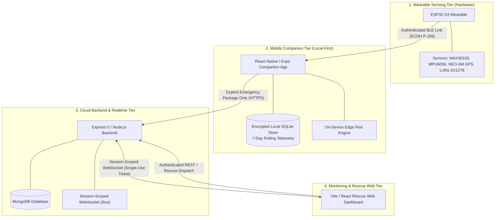

# 🛡️ TrailGuard / SWAAS

> **Smart Wearable Assistance & Alert System** — A safety-critical, local-first IoT ecosystem protecting hikers, lone workers, and vulnerable individuals with biometric tracking, edge fall detection, and real-time emergency dispatch.

[](https://github.com/SWAGAT10241/Smart-Wearable/actions/workflows/ci.yml)
[](https://github.com/SWAGAT10241/Smart-Wearable/actions/workflows/security.yml)
[](https://github.com/SWAGAT10241/Smart-Wearable/actions/workflows/codeql.yml)
[](LICENSE)

---

## 🧭 System Architecture

TrailGuard operates across four tightly decoupled, privacy-bounded tiers:



---

## ⚡ Core Capabilities

- **❤️ Biometric Telemetry:** Real-time photoplethysmography ($SpO_2$ blood oxygen & heart rate) via `MAX30100`.
- **🚨 Edge Fall Detection:** 6-axis IMU acceleration spike and immobility detection computed directly on-device.
- **📍 Emergency Location & LoRa:** Dual-path GPS coordinate relay with long-range sub-GHz LoRa beacon fallback.
- **🔒 Local-First Privacy:** Continuous telemetry stays in a 7-day rolling on-device SQLite buffer; cloud upload occurs **only** during active emergencies ($\le 6$ hours historical bound).
- **🛡️ Cryptographic Device Identity:** Pre-provisioned Ed25519 asymmetric signatures (`X-Device-Signature`) with anti-replay nonces.
- **🎫 Ephemeral Single-Use WebSockets:** 60-second tickets consumed via subprotocol handshake (`trailguard, ticket.<ticket>`).

---

## 🚀 Quickstart (Run Full Stack)

### Prerequisites
- **Node.js:** `v22.13.0+`
- **pnpm:** `v10+` / `v11+`
- **MongoDB:** `v6.0+` (local instance or MongoDB Atlas)

### 1. Clone & Install Dependencies
```bash
git clone https://github.com/SWAGAT10241/Smart-Wearable.git
cd Smart-Wearable
corepack enable
pnpm install
```

### 2. Configure Environment Files
Copy the provided `.env.example` templates across each subsystem:
```bash
cp backend/.env.example backend/.env
cp frontend/.env.example frontend/.env
cp mobile/.env.example mobile/.env
```

### 3. Start the Subsystems

Run services in separate terminals:

```bash
# Terminal 1: Backend API (http://localhost:3000)
cd backend && pnpm dev

# Terminal 2: Web Rescue Dashboard (http://localhost:5173)
cd frontend && pnpm dev

# Terminal 3 (Optional): Mobile Companion (Expo)
cd mobile && pnpm start
```

---

## 📂 Repository Layout

```text
TrailGuard/
├── backend/            # Express 5 REST APIs, WebSocket Manager, Ed25519 device auth
├── frontend/           # React 19 / Vite rescue monitoring dashboard & MapLibre GL
├── mobile/             # React Native / Expo 57 companion app (Local SQLite & BLE)
├── hardware/           # ESP32-S3 FreeRTOS C firmware, sensor drivers, & LoRa beacon
├── docs/               # Architecture decision records & migration guides
├── AGENTS.md           # AI Agent directives, file ownership, & safety invariants
├── ARCHITECTURE.md     # System component topology & interactive diagrams
├── SECURITY.md         # Vulnerability disclosure policy
└── SECURITY_AUDIT.md   # Comprehensive 30-item multi-tier security audit
```

---

## 🧪 Testing & Verification

Multi-tier regression suites run automatically on every Pull Request:

```bash
# Backend in-memory unit & security suites
cd backend && pnpm test

# Frontend component & client tests (Vitest) + Production build
cd frontend && pnpm run test:run && pnpm run build

# Mobile companion syntax & project health
cd mobile && node scripts/check-syntax.js && pnpm exec expo-doctor

# Hardware Python toolchain checks
python3 -m compileall -q hardware
```

---

## 🚀 Active Roadmap & Architectural Proposals

We are actively developing **[Phase 2: Mobile Local-First Privacy & Edge Risk Engine](https://github.com/SWAGAT10241/Smart-Wearable/milestone/4)** on the `SWAAS` branch:

- 📢 **Phase 2 Planning:** [Discussion #153](https://github.com/SWAGAT10241/Smart-Wearable/discussions/153)
- 💡 **Strategic Ideas & Proposals:** [Discussion #154](https://github.com/SWAGAT10241/Smart-Wearable/discussions/154)
- 🌐 **Polyglot Architecture RFC:** [Discussion #158 (Rust + Go + Node.js + Python)](https://github.com/SWAGAT10241/Smart-Wearable/discussions/158)
- 📄 **Technical Blueprints:** [Polyglot Architecture Plan](docs/POLYGLOT_ARCHITECTURE_PLAN.md) · [Strategic Roadmap](STRATEGIC_REPOSITORY_ROADMAP.md)

---

## 📖 In-Depth Documentation

For exhaustive technical references, consult the **[Official SWAAS GitHub Wiki](https://github.com/SWAGAT10241/Smart-Wearable/wiki)**:

| Guide / Chapter | Topic |
| :--- | :--- |
| **[02 — System Architecture](https://github.com/SWAGAT10241/Smart-Wearable/wiki/02---System-Architecture)** | Detailed dataflow, transport contracts, and component mapping |
| **[06 — Security Architecture](https://github.com/SWAGAT10241/Smart-Wearable/wiki/06---Security-Architecture)** | 7 Zero-tolerance invariants, RBAC matrix, and fail-closed audit |
| **[16 — Privacy & Governance](https://github.com/SWAGAT10241/Smart-Wearable/wiki/16---Privacy-&-Data-Governance)** | Local-first storage model, 6h emergency bounds, and TTL cleanup |
| **[17 — Real-Time Communication](https://github.com/SWAGAT10241/Smart-Wearable/wiki/17---Real-Time-Communication)** | Single-use WebSocket tickets, subprotocols, and scoped routing |
| **[18 — Device Lifecycle](https://github.com/SWAGAT10241/Smart-Wearable/wiki/18---Device-Provisioning-&-Lifecycle)** | Factory provisioning, Ed25519 pairing, and receipt verification |
| **[Polyglot Architecture Plan](docs/POLYGLOT_ARCHITECTURE_PLAN.md)** | 4-Language backend specification (Rust + Go + Node.js + Python) |
| **[Knowledge Graph Hub](https://github.com/SWAGAT10241/Smart-Wearable/wiki/Knowledge-Graph)** | Codebase AST graph (2,012 nodes · 3,317 edges · 147 communities) |

---

## 📄 License & Safety Notice

Distributed under the **MIT License**. See [LICENSE](LICENSE) for details.

> ⚠️ **Safety Disclaimer:** SWAAS / TrailGuard is an assistive engineering platform and does not replace certified search-and-rescue beacons, satellite communicators, or professional medical devices.
