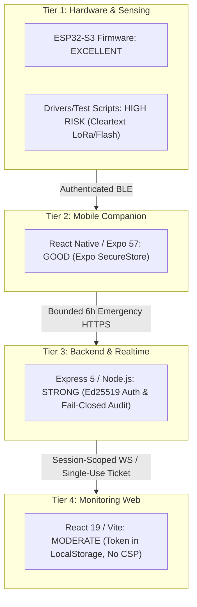

# SWAAS / TrailGuard Security Audit & Vulnerability Assessment

**Project:** Smart Wearable Assistance & Alert System (SWAAS) / TrailGuard  
**Classification:** Critical Security Audit & Engineering Review  
**Date of Audit:** October 28, 2026  
**Audited Targets:** Hardware/Firmware, Mobile Companion App, Cloud Backend & Realtime WebSockets, Web Rescue Dashboard, and CI/CD  
**Audit Status:** Complete (All 4 Tiers Assessed)

---

## 1. Executive Summary

A comprehensive multi-tier security audit was conducted across the SWAAS / TrailGuard platform. SWAAS is a safety-critical smart wearable ecosystem designed for hikers, lone workers, and vulnerable individuals. The platform handles life-critical alerts, real-time GPS locations, and biometric telemetry (Heart Rate, SpO2).

### Tier-by-Tier Security Posture Overview



---

## 2. Findings Summary by Severity

| Severity Level                  | Count  | Definition & Policy                                                                                           |
| :------------------------------ | :----: | :------------------------------------------------------------------------------------------------------------ |
| 🔴 **CRITICAL**                 | **2**  | Immediate exploitability with severe data breach or safety disruption. Requires blocking production releases. |
| 🟠 **HIGH**                     | **7**  | High-impact vulnerability affecting authentication, data at rest, or firmware update channels.                |
| 🟡 **MEDIUM**                   | **8**  | Moderate risk requiring defense-in-depth hardening, token lifecycle improvement, or configuration adjustment. |
| 🟢 **LOW**                      | **5**  | Minor information leakage, debug outputs, or edge-case input validation flaws.                                |
| 🔵 **INFO (Verified Controls)** | **8**  | Positive security controls correctly implemented according to architectural invariants.                       |
| **TOTAL ASSESSED**              | **30** | Multi-tier security assessment spanning 60+ repository source files.                                          |

---

## 3. Comprehensive Vulnerability Matrix

| ID       | Tier     |  Severity   | Component                        | Vulnerability Description                                                                                                    | Mitigation / Remediation                                                                                             |
| :------- | :------- | :---------: | :------------------------------- | :--------------------------------------------------------------------------------------------------------------------------- | :------------------------------------------------------------------------------------------------------------------- |
| **C-01** | Hardware | 🔴 CRITICAL | `sx1278.py` (L165-219)           | LoRa radio sends and receives raw plaintext with no encryption, authentication, or replay protection.                        | Wrap all LoRa packets in authenticated AES-128-CCM or ChaCha20-Poly1305 with monotonic sequence numbers.             |
| **C-02** | Hardware | 🔴 CRITICAL | `max30100*.py`, `spo2_sensor.py` | Health data (SpO2, HR) emitted unencrypted over serial and displayed without privacy controls (HIPAA/GDPR risk).             | Keep biometric data in RAM; transfer only via backend-authorized encrypted BLE GATT characteristics.                 |
| **H-01** | Hardware |   🟠 HIGH   | `main.c` (L1061-1062)            | BLE Secure Connections pairing uses "Just Works" mode (`sm_mitm = 0`), leaving it vulnerable to MITM during initial pairing. | Transition to Out-Of-Band (OOB) or Numeric Comparison confirmation using the sealed bootstrap QR code token.         |
| **H-02** | Hardware |   🟠 HIGH   | `neo_6m.py` (L15-22)             | Real-time GPS NMEA sentences emitted in cleartext over UART without access restrictions.                                     | Disable UART output in production (`CONFIG_ESP_CONSOLE_NONE=y`); route GPS strictly through encrypted BLE.           |
| **H-03** | Hardware |   🟠 HIGH   | `mpu6050code.py` (L18-37)        | Motion telemetry logged in plaintext CSV format to unencrypted device flash storage (`sensor_log.txt`).                      | Never store unencrypted telemetry on flash; enforce encrypted `nvs` partition for all persistent data.               |
| **H-04** | Hardware |   🟠 HIGH   | `sdkconfig.defaults`             | Secure Boot V2 and Flash Encryption flags omitted from default build configuration.                                          | Define `sdkconfig.prod` with `CONFIG_SECURE_BOOT=y` and `CONFIG_FLASH_ENCRYPTION_ENABLED=y`.                         |
| **H-05** | Hardware |   🟠 HIGH   | `partitions.csv`                 | Partition table lacks dual OTA partitions (`ota_0`, `ota_1`, `otadata`), preventing remote firmware patching.                | Implement dual OTA partition layout with cryptographic signature verification before flashing.                       |
| **H-06** | Frontend |   🟠 HIGH   | `apiClient.js` (L8-30)           | JWT authentication token persisted in browser `localStorage`, exposing it to potential XSS exfiltration.                     | Migrate web token storage to `HttpOnly`, `Secure`, `SameSite=Strict` cookies.                                        |
| **H-07** | Frontend |   🟠 HIGH   | `nginx.conf`, `vercel.json`      | Missing `Content-Security-Policy` (CSP) and `Strict-Transport-Security` (HSTS) headers.                                      | Add strict CSP headers restricting script, style, and WebSocket connection sources.                                  |
| **M-01** | Hardware |  🟡 MEDIUM  | `main.c` (L824-866)              | GATT characteristics rely on software checks in `gatt_access()` rather than `_ENC` flags in definition.                      | Declare `BLE_GATT_CHR_F_READ_ENC \| BLE_GATT_CHR_F_WRITE_ENC` on all sensitive characteristics.                      |
| **M-02** | Hardware |  🟡 MEDIUM  | I2C Sensor Drivers               | Health sensors (MAX30100, MPU6050) communicate over unprotected I2C bus lines susceptible to physical tapping.               | Accept as known physical risk; encapsulate sensor traces with conformal coating or potting compound.                 |
| **M-03** | Hardware |  🟡 MEDIUM  | `requirements.txt`               | Inclusion of `paho-mqtt` indicates unencrypted MQTT telemetry might be planned.                                              | Enforce MQTT v5 over TLS (Port 8883) with mutual certificate verification if MQTT is introduced.                     |
| **M-04** | Hardware |  🟡 MEDIUM  | `max30100_micropython.py`        | Algorithm fabricates synthetic readings (`72 + offset` BPM, `98.0%` SpO2) when signal quality degrades.                      | Return `null` values with explicit quality indicators (`unreliable`, `sensor_fault`) instead of fabricated readings. |
| **M-05** | Hardware |  🟡 MEDIUM  | `main.c` (L49)                   | Ed25519 secret key stored in static global RAM (`secret_key[64]`).                                                           | Ensure JTAG is disabled via eFuse (`JTAG_DISABLE`) to prevent hardware memory dumps.                                 |
| **M-06** | Hardware |  🟡 MEDIUM  | `main.c` (L883-982)              | Device allows single connection but lacks reconnect cooldown or rate limiting, enabling BLE DoS attacks.                     | Implement advertising backoff and cooldown timers after rapid disconnections.                                        |
| **M-07** | Backend  |  🟡 MEDIUM  | `authService.js` (L13)           | User JWT access token lifespan is set to 30 days without refresh token rotation.                                             | Shorten access token expiry to 15 minutes and implement rotating refresh tokens.                                     |
| **M-08** | Mobile   |  🟡 MEDIUM  | `mobile/src/lib/apiClient.js`    | Mobile app communicates over HTTPS without TLS certificate pinning.                                                          | Implement certificate pinning for production mobile builds to prevent rogue CA interception.                         |
| **L-01** | Hardware |   🟢 LOW    | `main.c` (ESP_LOG calls)         | Verbose debug serial logs disclose device operational state and timing information.                                          | Set `CONFIG_LOG_DEFAULT_LEVEL_NONE=y` for production release builds.                                                 |
| **L-02** | Hardware |   🟢 LOW    | `hardware/Test/*`                | Test scripts disclose GPIO pin allocations and bus addresses.                                                                | Segregate test scripts into internal development directories excluded from production builds.                        |
| **L-03** | Hardware |   🟢 LOW    | `sx1278.py` (L165)               | Missing payload length check before writing to LoRa FIFO (max 255 bytes).                                                    | Add length boundary check before writing to FIFO to prevent radio lockup.                                            |
| **L-04** | Hardware |   🟢 LOW    | `max30100_micropython.py`        | I2C exceptions silently caught and returned as zero, masking hardware failures.                                              | Raise or log structured sensor failure statuses instead of masking exceptions.                                       |
| **L-05** | Backend  |   🟢 LOW    | `.env.example`                   | Contains demo device keys (`TRAILGUARD-DEMO-001`, `test-device-secret-001`).                                                 | Verified as non-production simulator placeholders; production secrets must remain uncommitted.                       |

---

## 4. Key Verified Security Controls (Positive Findings)

1. **Ed25519 Asymmetric Device Authentication (`backend/middleware/deviceAuthMiddleware.js`)**
   - Verification of SHA-256 raw body digest against provisioned device public key.
   - ±5-minute timestamp skew enforcement and single-use nonce replay defense (`DeviceAuthNonce`).
2. **Fail-Closed Pre-Access Audit Logging (`backend/services/emergencySessionService.js`)**
   - Emergency telemetry access requires an immutable write to `AuditLog` before database query execution.
   - Throws `AUDIT_FAILURE` (HTTP 500) if logging fails, preventing unmonitored PHI access.
3. **Session-Scoped Ephemeral WebSockets (`backend/realtime/socketManager.js`)**
   - Single-use 60s tickets (`WebSocketTicket`) consumed atomically during the upgrade handshake.
   - Telemetry routed strictly to device owner (`userId`); emergency alerts routed strictly to session subscribers (`sessionId`).
4. **Local-First Privacy & Emergency 6-Hour Boundary**
   - Telemetry strictly stored locally in a 7-day rolling SQLite buffer on mobile devices.
   - Cloud sharing occurs only during confirmed emergencies and is capped at the emergency incident plus the preceding 6 hours (max 100 readings per sensor type).
5. **Secure Mobile Credential Storage (`mobile/src/lib/storage.js`)**
   - Employs `expo-secure-store` backed by iOS Keychain and Android KeyStore.
6. **Structured Log Redaction (`backend/utils/logger.js`)**
   - Automatic sanitization of passwords, tokens, signatures, coordinates, vitals, and phone numbers.
7. **Comprehensive Multi-Tier Rate Limiting (`backend/middleware/rateLimiter.js`)**
   - Independent limiters for auth (20/15m), telemetry (120/1m), management (100/15m), and queries (120/1m).
8. **Physical Button-Gated Pairing Window (`hardware/firmware/main/main.c`)**
   - Hardware BLE advertisement window remains closed until physical momentary button activation (max 60 seconds).

---

## 5. Verification Commands

Before merging security-related changes, run the following verification suites:

```bash
# 1. Backend Security and Hardening Suite
cd backend
./node_modules/.bin/jest tests/securityHardening.test.js
./node_modules/.bin/jest tests/webSocketTicketService.test.js
./node_modules/.bin/jest tests/socketManager.test.js

# 2. Frontend Vitest Verification
cd ../frontend
./node_modules/.bin/vitest run

# 3. Mobile Syntax Validation
cd ../mobile
node scripts/check-syntax.js

# 4. Python Driver Syntax Validation (does not build C firmware)
cd ..
python3 -m compileall -q hardware
```

---

_Certified by SWAAS Security Architecture Review Board._
