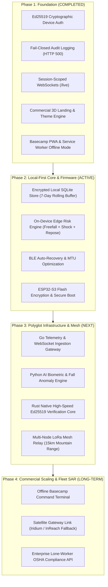
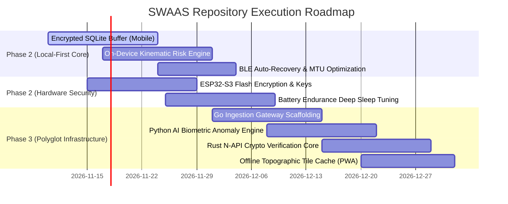

# SWAAS / TrailGuard — Strategic Repository Roadmap & Future Milestone Architecture

**Document Version:** 2.0.0  
**Target Repository:** `SWAGAT10241/Smart-Wearable` (Branch: `SWAAS`)  
**Architecture Single Source of Truth:** [AGENTS.md](AGENTS.md)  
**Technical Architecture Plan:** [docs/POLYGLOT_ARCHITECTURE_PLAN.md](docs/POLYGLOT_ARCHITECTURE_PLAN.md)  
**Companion Security Audit:** [SECURITY_AUDIT.md](SECURITY_AUDIT.md)

---

## 1. Executive Summary & Vision

SWAAS / TrailGuard is an autonomous, mission-critical safety platform designed for lone workers, alpine hikers, and search-and-rescue teams. Having completed the **Phase 1 Foundation** (cryptographic Ed25519 device signatures, fail-closed audit logs, session-scoped WebSockets, offline basecamp PWA, and commercial 3D landing page), the project is transitioning through **Phase 2 (Mobile Local-First Buffer & Hardware Tightening)** and into **Phase 3 (Polyglot Infrastructure & Scaled Ingestion)**.

---

## 2. 4-Tier Strategic Roadmap Matrix

### 📱 Tier 2: Mobile Companion Tier (Top Priority — Local-First Invariant 1)

> [!IMPORTANT]
> **Priority 1 Focus:** Currently, `HistoryScreen` fetches historical readings from cloud APIs. Under Invariant 1, continuous vitals must stay strictly local in an encrypted rolling 7-day SQLite buffer.

| Milestone | Objective | Deliverables | Target Timeline |
| :--- | :--- | :--- | :--- |
| **M2.1: Encrypted Local SQLite Buffer** | Implement rolling 7-day telemetry buffer on device | • SQLite table with automated 7-day rolling vacuum • Hardware-backed encryption via `expo-secure-store` key derivation • Zero cloud syncing during nominal health status | Sprint 1 (Active) |
| **M2.2: Mobile Edge Risk Engine** | On-device kinematic heuristic & fall detection | • 3-stage kinematic scoring: micro-freefall (<0.5g), impact shock (>3.0g), repose angle • 30s audible/haptic cancel countdown overlay • Offline dispatch packaging | Sprint 1–2 |
| **M2.3: Robust BLE Pipeline** | Industrial Bluetooth connection reliability | • Automatic reconnect with exponential backoff • Negotiated MTU 512 for batch telemetry packets • Background BLE state restoration | Sprint 2 |

---

### 🌐 Tier 3: Polyglot Cloud Backend & Scaled Real-Time Infrastructure

Detailed architectural blueprints available in [docs/POLYGLOT_ARCHITECTURE_PLAN.md](docs/POLYGLOT_ARCHITECTURE_PLAN.md).

| Milestone | Objective | Deliverables | Target Timeline |
| :--- | :--- | :--- | :--- |
| **M3.1: Go Ingestion Gateway** | Massive WebSocket & LoRa concurrency | • Standalone Go service handling 100k+ parallel streams • Sub-millisecond fan-out to Redis Pub/Sub • UDP listener for field basecamp hubs | Sprint 2–3 |
| **M3.2: Python AI Analytics Engine** | Biometric anomaly & false-alarm suppression | • Real-time kinematic fall trajectory evaluation • PPG arrhythmia & severe hypoxemia ($SpO_2$) detection • GPS drift Kalman filtering | Sprint 3 |
| **M3.3: Rust Cryptographic Engine** | Zero-GC asymmetric verification | • Bare-metal Ed25519 verification (`ed25519-dalek`) • N-API in-process addon for Node.js coordinator • Binary packet decompression | Sprint 3–4 |
| **M3.4: Node.js Orchestrator Hardening** | Incident coordination & audit lifecycle | • Active emergency session coordinator (48h TTL) • Fail-closed audit logging (`AUDIT_FAILURE`) • SAR GeoJSON & PDF mission dossier export | Sprint 4 |

---

### ⚡ Tier 1: Hardware & Firmware Tier (ESP32-S3 & LoRa)

| Milestone | Objective | Deliverables | Target Timeline |
| :--- | :--- | :--- | :--- |
| **M1.1: Flash Encryption & Key Storage** | Secure Boot V2 and eFuse hardware lock | • ESP32-S3 Flash Encryption enabled • Pre-provisioned Ed25519 private key stored in secure eFuse • Tamper detection and zero-knowledge memory wipe | Sprint 2 |
| **M1.2: Deep Sleep & Power Profiling** | Extend battery endurance to 72+ hours | • ULP (Ultra-Low Power) coprocessor pulse monitoring • Dynamic GPS duty cycling (1Hz during movement, 0.1Hz at rest) • LoRa low-power CAD (Channel Activity Detection) | Sprint 3 |
| **M1.3: Multi-Node LoRa Mesh Protocol** | Alpine relay hopping for dead-zone coverage | • Simple flood mesh protocol with hop-count TTL (max 3 hops) • Packet deduplication table on hardware nodes • Relay prioritization for emergency SOS packets | Sprint 3–4 |

---

### 🖥️ Tier 4: Rescue Web & Monitoring Dashboard

| Milestone | Objective | Deliverables | Target Timeline |
| :--- | :--- | :--- | :--- |
| **M4.1: Offline Topographic Map Tile Cache** | Basecamp offline map visualization | • Vector contour tile pre-caching in IndexedDB via Service Worker • Offline elevation profile render for search-and-rescue navigation • MapLibre GL offline style switcher | Sprint 2–3 |
| **M4.2: Realtime Dispatch Coordinator UI** | Multi-responder assignment & command console | • Drag-and-drop responder dispatch assignments • Realtime ETA calculation based on terrain slope and telemetry • Live WebSocket reconnection banner with automatic ticket re-acquisition | Sprint 3 |
| **M4.3: Mission Telemetry Analytics** | Alpine mission retrospective analytics | • Multi-track elevation vs. cardiac stress playback • Incident timeline scrubber with 6-hour historical query bounds • High-contrast SAR daylight field mode | Sprint 4 |

---

## 3. Recommended Sprint Execution Plan

---

## 4. Architectural Guardrails (Zero-Tolerance Invariants)

All PRs, microservices, and sprint tasks must strictly comply with the established repository rules:
1. **Never merge `SWAAS` into `main`:** All active development remains isolated on `SWAAS`.
2. **Local-First Privacy:** No continuous background health telemetry to the cloud during nominal conditions.
3. **Emergency-Bounded Cloud Sharing:** Cloud telemetry bound strictly to active incident + max 6 hours.
4. **Fail-Closed Audit Logging:** Health and location queries must write to `AuditLog` first; failure throws `AUDIT_FAILURE` (HTTP 500).
5. **Human-Operated Version Control:** AI agents never run git mutation commands directly.
