# System Architecture & Component Topology

**Project:** SWAAS (Smart Wearable Assistance & Alert System) / TrailGuard  
**Reference:** [GitDiagram System Topology](https://gitdiagram.com/swagat10241/smart-wearable)  

---

## 1. High-Level Component Flowchart

```mermaid
%% Generated by https://gitdiagram.com/swagat10241/smart-wearable
flowchart TD

subgraph group_wearable["Wearable sensing"]
  node_drivers["Sensor drivers"]
end

subgraph group_backend["Backend services"]
  node_api["Express API<br/>[app.js]"]
  node_auth_routes["Auth routes<br/>[authRoutes.js]"]
  node_auth_controller["Auth controller<br/>[authController.js]"]
  node_auth_service["Auth service<br/>[authService.js]"]
  node_device_controller["Device controller"]
  node_device_service["Device service<br/>[deviceService.js]"]
  node_telemetry_controller["Telemetry controller"]
  node_telemetry_service["Telemetry processing"]
  node_vitals_domain["Vitals history<br/>[vitalsService.js]"]
  node_environment_domain["Environment history"]
  node_location_domain["Location history<br/>[locationService.js]"]
  node_fall_domain["Fall management<br/>[fallService.js]"]
  node_emergency["Emergency alerts"]
end

subgraph group_data["Data and realtime"]
  node_mongo[("MongoDB")]
  node_socket["WebSocket broadcast<br/>[socketManager.js]"]
end

subgraph group_clients["Monitoring clients"]
  node_web_app["Web application<br/>[App.jsx]"]
  node_web_dashboard["Web dashboard<br/>[Dashboard.jsx]"]
  node_web_history["Web history<br/>[History.jsx]"]
  node_web_settings["Web settings<br/>[Settings.jsx]"]
  node_web_api["Web API client<br/>[apiClient.js]"]
  node_web_live["Web live data"]
  node_mobile_app["Mobile application<br/>[App.js]"]
  node_mobile_api["Mobile API client<br/>[apiClient.js]"]
  node_mobile_live["Mobile live data<br/>[LiveDataContext.js]"]
end

node_wearer_device(("Wearable"))

node_wearer_device -->|"sends telemetry"| node_api
node_drivers -.->|"provides sensor access"| node_wearer_device
node_api -->|"mounts routes"| node_auth_routes
node_auth_routes -->|"routes requests"| node_auth_controller
node_auth_controller -->|"delegates auth"| node_auth_service
node_auth_service -->|"reads and writes users"| node_mongo
node_device_controller -->|"delegates device actions"| node_device_service
node_telemetry_controller -->|"delegates ingestion"| node_telemetry_service
node_telemetry_service -->|"stores readings"| node_mongo
node_vitals_domain -->|"persists vitals"| node_mongo
node_environment_domain -->|"persists readings"| node_mongo
node_location_domain -->|"stores location history"| node_mongo
node_fall_domain -->|"stores fall events"| node_mongo
node_api -->|"uses broadcast"| node_socket
node_socket -->|"streams events"| node_web_live
node_web_app -->|"routes to"| node_web_dashboard
node_web_app -->|"routes to"| node_web_history
node_web_app -->|"routes to"| node_web_settings
node_web_dashboard -.->|"requests monitoring data"| node_web_api
node_web_history -.->|"requests history"| node_web_api
node_web_api -->|"calls REST API"| node_api
node_mobile_app -.->|"uses API client"| node_mobile_api
node_mobile_api -->|"calls REST API"| node_api
node_mobile_live -.->|"receives live updates"| node_api
node_fall_domain -.->|"triggers alerts"| node_emergency

click node_drivers "https://github.com/swagat10241/smart-wearable/tree/main/hardware/Drivers"
click node_api "https://github.com/swagat10241/smart-wearable/blob/main/backend/app.js"
click node_auth_routes "https://github.com/swagat10241/smart-wearable/blob/main/backend/routes/authRoutes.js"
click node_auth_controller "https://github.com/swagat10241/smart-wearable/blob/main/backend/controllers/authController.js"
click node_auth_service "https://github.com/swagat10241/smart-wearable/blob/main/backend/services/authService.js"
click node_device_controller "https://github.com/swagat10241/smart-wearable/blob/main/backend/controllers/deviceController.js"
click node_device_service "https://github.com/swagat10241/smart-wearable/blob/main/backend/services/deviceService.js"
click node_telemetry_controller "https://github.com/swagat10241/smart-wearable/blob/main/backend/controllers/telemetryController.js"
click node_telemetry_service "https://github.com/swagat10241/smart-wearable/blob/main/backend/services/telemetryService.js"
click node_vitals_domain "https://github.com/swagat10241/smart-wearable/blob/main/backend/services/vitalsService.js"
click node_environment_domain "https://github.com/swagat10241/smart-wearable/blob/main/backend/services/environmentService.js"
click node_location_domain "https://github.com/swagat10241/smart-wearable/blob/main/backend/services/locationService.js"
click node_fall_domain "https://github.com/swagat10241/smart-wearable/blob/main/backend/services/fallService.js"
click node_emergency "https://github.com/swagat10241/smart-wearable/blob/main/backend/services/emergencyService.js"
click node_socket "https://github.com/swagat10241/smart-wearable/blob/main/backend/realtime/socketManager.js"
click node_web_app "https://github.com/swagat10241/smart-wearable/blob/main/frontend/src/App.jsx"
click node_web_dashboard "https://github.com/swagat10241/smart-wearable/blob/main/frontend/src/pages/Dashboard.jsx"
click node_web_history "https://github.com/swagat10241/smart-wearable/blob/main/frontend/src/pages/History.jsx"
click node_web_settings "https://github.com/swagat10241/smart-wearable/blob/main/frontend/src/pages/Settings.jsx"
click node_web_api "https://github.com/swagat10241/smart-wearable/blob/main/frontend/src/lib/apiClient.js"
click node_web_live "https://github.com/swagat10241/smart-wearable/blob/main/frontend/src/context/LiveDataContext.jsx"
click node_mobile_app "https://github.com/swagat10241/smart-wearable/blob/main/mobile/App.js"
click node_mobile_api "https://github.com/swagat10241/smart-wearable/blob/main/mobile/src/lib/apiClient.js"
click node_mobile_live "https://github.com/swagat10241/smart-wearable/blob/main/mobile/src/context/LiveDataContext.js"

classDef toneNeutral fill:#f8fafc,stroke:#334155,stroke-width:1.5px,color:#0f172a
classDef toneBlue fill:#dbeafe,stroke:#2563eb,stroke-width:1.5px,color:#172554
classDef toneAmber fill:#fef3c7,stroke:#d97706,stroke-width:1.5px,color:#78350f
classDef toneMint fill:#dcfce7,stroke:#16a34a,stroke-width:1.5px,color:#14532d
classDef toneRose fill:#ffe4e6,stroke:#e11d48,stroke-width:1.5px,color:#881337
classDef toneIndigo fill:#e0e7ff,stroke:#4f46e5,stroke-width:1.5px,color:#312e81
classDef toneTeal fill:#ccfbf1,stroke:#0f766e,stroke-width:1.5px,color:#134e4a
class node_drivers toneBlue
class node_api,node_auth_routes,node_auth_controller,node_auth_service,node_device_controller,node_device_service,node_telemetry_controller,node_telemetry_service,node_vitals_domain,node_environment_domain,node_location_domain,node_fall_domain,node_emergency toneAmber
class node_mongo,node_socket toneMint
class node_web_app,node_web_dashboard,node_web_history,node_web_settings,node_web_api,node_web_live,node_mobile_app,node_mobile_api,node_mobile_live toneRose
class node_wearer_device toneIndigo
```

---

## 2. Architectural Subsystem Breakdown

### 2.1 Hardware Sensing Tier (`hardware/`)
- **Device Platform:** Espressif ESP32-S3 microcontroller with BLE 5.0 and LoRa transceivers.
- **Sensor Drivers:**
  - `MAX30100`: Photoplethysmography (PPG) sensor for continuous Heart Rate and SpO2 calculation.
  - `MPU6050`: 6-axis Inertial Measurement Unit (IMU) capturing raw acceleration, gyroscope tilt angles, and impact spikes.
  - `NEO-6M GPS`: Global positioning module providing latitude, longitude, altitude, and satellite tracking metrics.
  - `SX1278 LoRa`: Long-range sub-GHz emergency beacon broadcasting when cellular connectivity is degraded.

### 2.2 Local-First Mobile Companion (`mobile/`)
- **Framework:** React Native / Expo SDK 57.
- **Local Storage:** SQLite (SQLCipher) retaining 7-day rolling window of sensor readings.
- **Edge Risk Engine:** Evaluates sensor streams in real time for anomalies and potential falls without sending data to the cloud.
- **BLE Management:** Authenticated pairing via LE Secure Connections (ECDH P-256) and bonded link-layer encryption.

### 2.3 Express & MongoDB Backend (`backend/`)
- **Framework:** Node.js / Express 5 with Mongoose 9 ODM.
- **Security & RBAC:** Hierarchical role authorization (`citizen`, `responder`, `coordinator`, `admin`).
- **Cryptographic Device Ingestion:** Hardware requests authenticated using Ed25519 digital signatures (`X-Device-Signature`) and anti-replay nonces.
- **Audit Engine:** Fail-closed immutable auditing (`AuditLog`) on sensitive health data.
- **Ephemeral Retention:** Automatic TTL cleanup for emergency sessions and WebSocket upgrade tickets.

### 2.4 Monitoring & Rescue Dashboard (`frontend/`)
- **Framework:** React 19 / Vite 6 / Tailwind CSS / MapLibre GL.
- **Emergency Live View:** Ephemeral session tracking, real-time GPS coordinate plotting, and 6-hour bounded vitals replay.
- **WebSocket Protocol:** Ephemeral ticket authentication (`trailguard, ticket.<ticket>`) over `/live`.

---

## 3. Related Specifications & Architecture Documentation

For in-depth architectural and implementation contracts across all phases:
- **[AGENTS.md](file:///Users/swagatsouravdhar/WEB DEVELOPMENT/TrailGuard/AGENTS.md)**: AI Agent Directives, Golden Rules, Verification Suites & Workflow Protocol.
- **[Day 3 — Device & API Architecture](file:///Users/swagatsouravdhar/WEB DEVELOPMENT/TrailGuard/docs/architecture/day-3-device-and-api-architecture.md)**: Device Provisioning, Ed25519 Challenges, BLE Contracts.
- **[Day 4 — Risk & Emergency Models](file:///Users/swagatsouravdhar/WEB DEVELOPMENT/TrailGuard/docs/architecture/day-4-risk-and-emergency-models.md)**: `EmergencySession`, `RiskAssessment`, Ephemeral Data Models.
- **[Day 5 — WebSocket & Emergency Communication](file:///Users/swagatsouravdhar/WEB DEVELOPMENT/TrailGuard/docs/architecture/day-5-websocket-and-emergency-communication.md)**: Ephemeral Tickets, Real-Time Protocols, Session Subscriptions.
- **[Day 6 — Privacy, Security & Authorization](file:///Users/swagatsouravdhar/WEB DEVELOPMENT/TrailGuard/docs/architecture/day-6-privacy-security-authorization.md)**: Fail-Closed Auditing, Redacted Logging, 6-Hour Bounded Access.
