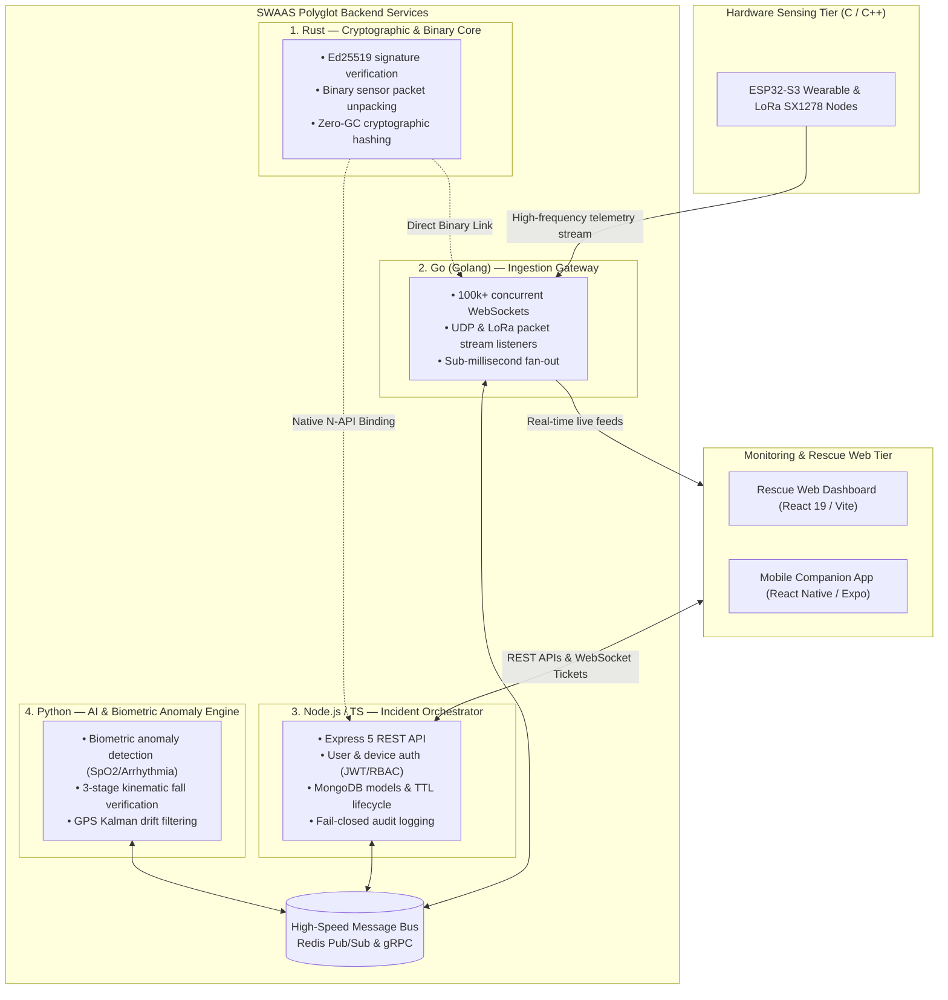
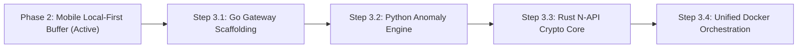

# 🌐 SWAAS / TrailGuard — 4-Language Polyglot Architecture Plan

**Document Version:** 1.0.0  
**Status:** PROPOSED / UNDER REVIEW  
**Companion Documents:** [AGENTS.md](../AGENTS.md), [SECURITY_AUDIT.md](../SECURITY_AUDIT.md), [STRATEGIC_REPOSITORY_ROADMAP.md](../STRATEGIC_REPOSITORY_ROADMAP.md)

---

## 1. Executive Summary & Vision

As SWAAS / TrailGuard scales from individual hikers to enterprise lone-worker monitoring and search-and-rescue (SAR) fleet operations, a single runtime cannot optimize across all constraints simultaneously. 

By transitioning to a **4-Language Specialized Polyglot Architecture**, each tier is implemented in the language mathematically and practically optimal for its operational domain:

---

## 2. The 4-Language Division of Responsibilities

### 🦀 1. Rust: Cryptographic Verification & Binary Unpacking
- **Location:** `services/crypto-rust/` or embedded in Node.js via **Napi-RS** (`backend/native/crypto`).
- **Core Mission:** Absolute memory safety, zero-cost abstractions, and sub-microsecond cryptographic math without garbage collection pauses.
- **Responsibilities:**
  - Fast asymmetric Ed25519 verification (`ed25519-dalek`) verifying raw request digests against `Device.publicKey`.
  - Replay-attack nonce ring-buffer validation.
  - Binary Protobuf / MessagePack decompression of compact LoRa sensor payloads.

### 🦫 2. Go (Golang): Real-Time Network & Ingestion Gateway
- **Location:** `services/gateway-go/`
- **Core Mission:** Massive network concurrency and ultra-low memory overhead (~2KB per Goroutine).
- **Responsibilities:**
  - Handles 100,000+ simultaneous persistent WebSocket connections on port `8080`.
  - Receives UDP broadcasts and long-range LoRa packet bursts from forward basecamp gateways.
  - Validates incoming single-use tickets issued by Node.js.
  - Publishes parsed telemetry frames to Redis Pub/Sub in $<1\text{ms}$.

### 🟩 3. Node.js (Express 5 / TypeScript): Application Orchestration Hub
- **Location:** `backend/` (Current primary service).
- **Core Mission:** Business domain logic, security governance, and persistence coordinator.
- **Responsibilities:**
  - User registration, authentication (JWT/bcrypt), and role-based access control (RBAC).
  - Single-use 60-second WebSocket ticket issuance (`POST /api/emergency/ws-ticket`).
  - Active Emergency Session lifecycle and 48-hour automated TTL expiration.
  - Fail-Closed Audit Logging (`AuditLog.create()` throwing `AUDIT_FAILURE` on database disruption).
  - REST endpoints consumed by the React 19 Rescue Dashboard.

### 🐍 4. Python (FastAPI / PyTorch): AI & Biometric Anomaly Detection
- **Location:** `services/analytics-py/`
- **Core Mission:** Machine learning model inference, statistical signal processing, and false-alarm suppression.
- **Responsibilities:**
  - Real-time kinematic fall verification: analyzes 6-axis IMU acceleration spikes ($>2.5g$) and post-shock immobility ($>10s$) using pre-trained edge models.
  - Continuous PPG signal analysis: flags severe hypoxemia ($SpO_2 < 85\%$) and sudden bradycardia/tachycardia anomalies.
  - GPS Kalman filtering: corrects mountain satellite multipath reflection and altitude drift before plotting coordinates on rescue topo maps.

---

## 3. Inter-Service Communication Contracts

All polyglot microservices communicate over strict, decoupled channels:

| Communication Channel | Sender | Receiver | Protocol | Latency SLA |
| :--- | :--- | :--- | :--- | :--- |
| **Telemetry Ingestion Bus** | Go Gateway | Python Engine & Node.js | Redis Pub/Sub | $< 2\text{ms}$ |
| **Emergency Escalation** | Python Engine | Node.js Orchestrator | gRPC / HTTP/2 | $< 5\text{ms}$ |
| **Crypto Verification** | Node.js / Go | Rust Core | In-process N-API / C-ABI | $< 50\mu\text{s}$ |
| **Ticket Handshake** | Node.js | Go Gateway | Redis Key Lookup (`SETEX`) | $< 1\text{ms}$ |

---

## 4. Preservation of Core Safety Invariants

Regardless of language, all microservices strictly uphold TrailGuard's 7 Zero-Tolerance Invariants:

1. **Invariant 1 (Local-First Privacy):** Continuous normal health telemetry stays local on-device. The polyglot backend coordinates active emergencies only.
2. **Invariant 2 (Emergency-Bounded Cloud Sharing):** Ingestion pipelines reject historical telemetry exceeding the 6-hour pre-incident bound.
3. **Invariant 3 (Fail-Closed Audit Logging):** Any failure to log health/location data access immediately throws `AUDIT_FAILURE` (HTTP 500) and returns zero bytes.
4. **Invariant 4 (Cryptographic Device Auth):** No unauthenticated sensor frames enter the Redis bus without Ed25519 signature validation.
5. **Invariant 5 (Ephemeral TTL Cleanup):** Emergency sessions expire automatically after 48 hours; tickets expire in 60 seconds.
6. **Invariant 6 (Session-Scoped Real-Time Delivery):** Global broadcasts are prohibited; streams are routed strictly by authenticated `sessionId`.
7. **Invariant 7 (Structured Redacted Logging):** Passwords, JWTs, private keys, biometric values, and raw GPS coordinates are redacted across all logs in all languages.

---

## 5. Phased Implementation Roadmap

- **Step 3.1 (Go Gateway):** Scaffold `services/gateway-go` with high-performance WebSocket upgrader and Redis publisher.
- **Step 3.2 (Python Engine):** Scaffold `services/analytics-py` with FastAPI and scikit-learn/NumPy kinematic fall filters.
- **Step 3.3 (Rust Core):** Scaffold `services/crypto-rust` using `ed25519-dalek` and generate N-API bindings for Node.js.
- **Step 3.4 (Orchestration):** Update `docker-compose.yml` with multi-stage builds and isolated internal bridge networks.
