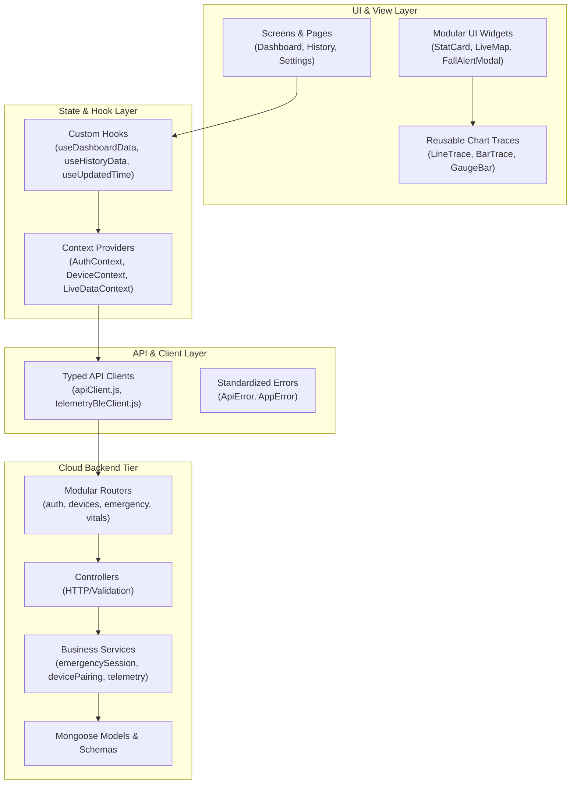

# SWAAS / TrailGuard Codebase Architecture & Modular Organization

**Project:** Smart Wearable Assistance & Alert System (SWAAS) / TrailGuard  
**Classification:** Engineering Architecture, Folder Structure & Modular Conventions  
**Companion Documents:** [Unified Agent Directives](../../AGENTS.md) | [Security Audit Assessment](../../SECURITY_AUDIT.md)

---

## 1. Architectural Philosophy & Layered Separation

TrailGuard enforces strict separation of concerns across all four tiers of the ecosystem:

1. **Presentation / UI Layer:** Pure visual rendering, accessibility, and user input capture. UI components do not perform direct database operations or raw calculations.
2. **State & Logic Layer:** Custom hooks and React Context providers manage data fetching, WebSocket events, caching, and state transitions.
3. **Service & Domain Layer:** Backend business logic, cryptographic signing, access authorization, and data transformation are encapsulated in dedicated services.
4. **Data & Storage Layer:** Ephemeral MongoDB collections with TTL indexes on the cloud, and encrypted SQLite (SQLCipher) rolling 7-day buffers on mobile.



---

## 2. Directory Structure Across All Tiers

### 2.1 Backend (`backend/`)

The backend strictly adheres to the **Route → Controller → Service → Model** architecture:

```text
backend/
├── config/                  <- Validated, immutable environment and auth configs
│   ├── env.js               <- Centralized dotenv loading and production validation
│   ├── db.js                <- MongoDB connection lifecycle management
│   ├── passport.js          <- Google OAuth 2.0 Passport strategy
│   └── permissions.js       <- Role-based access control (RBAC) permission map
├── controllers/             <- Request validation, HTTP status codes, response mapping
│   ├── authController.js
│   ├── deviceController.js
│   ├── deviceRegistrationController.js <- Pairing challenge & receipt endpoints
│   ├── emergencySessionController.js   <- Incident handling & dispatch
│   ├── environmentController.js
│   ├── fallController.js
│   ├── locationController.js
│   ├── telemetryController.js
│   └── vitalsController.js
├── middleware/              <- Security, auth, and pipeline guards
│   ├── authMiddleware.js        <- User JWT verification
│   ├── deviceAuthMiddleware.js  <- Asymmetric Ed25519 signature validation
│   ├── authorizeRole.js         <- RBAC enforcement middleware
│   ├── rateLimiter.js           <- Tiered express-rate-limit guards
│   ├── validate.js              <- Schema validation middleware
│   ├── errorHandler.js          <- Centralized error handler
│   └── notFoundHandler.js       <- 404 catch-all
├── models/                  <- Mongoose schemas and compound TTL indexes
│   ├── User.js
│   ├── Device.js
│   ├── DevicePairing.js
│   ├── DeviceAuthNonce.js   <- Replay defense TTL store
│   ├── EmergencySession.js  <- 48-hour ephemeral incident record
│   ├── RiskAssessment.js    <- On-device anomaly snapshot
│   ├── WebSocketTicket.js   <- 60-second single-use ticket
│   ├── AuditLog.js          <- Immutable append-only audit trail
│   ├── VitalsReading.js
│   ├── EnvironmentReading.js
│   ├── LocationReading.js
│   └── FallEvent.js
├── realtime/
│   └── socketManager.js     <- Authenticated, session-scoped WebSocket server
├── routes/                  <- Route declaration and middleware binding
│   ├── index.js             <- Centralized API router mounting
│   ├── authRoutes.js
│   ├── deviceRoutes.js
│   ├── deviceRegistrationRoutes.js
│   ├── deviceManagementRoutes.js
│   ├── emergencyRoutes.js
│   ├── vitalsRoutes.js
│   ├── environmentRoutes.js
│   ├── locationRoutes.js
│   └── fallRoutes.js
├── services/                <- Domain logic, cryptographic operations, DB queries
│   ├── authService.js
│   ├── deviceService.js
│   ├── devicePairingService.js
│   ├── deviceProvisioningService.js
│   ├── deviceAuthorizationReceiptService.js
│   ├── emergencySessionService.js
│   ├── telemetryService.js
│   └── webSocketTicketService.js
└── utils/
    ├── appError.js          <- Operational AppError with HTTP status & code
    ├── asyncHandler.js      <- Async route wrapper
    ├── logger.js            <- Structured, redacted logging utility
    └── response.js          <- Standardized API response builder
```

---

### 2.2 Frontend Web Dashboard (`frontend/`)

The web dashboard separates UI components into atomic charts, common widgets, and layout elements, while delegating logic to custom hooks:

```text
frontend/src/
├── assets/                  <- Static brand assets and images
├── components/
│   ├── app/                 <- Core application layout & navigation shell
│   │   ├── AppLayout.jsx
│   │   ├── PageHeader.jsx
│   │   ├── ProfileMenu.jsx
│   │   └── NotificationBell.jsx
│   ├── auth/                <- Authentication forms & OAuth layouts
│   │   ├── AuthCard.jsx
│   │   ├── AuthLayout.jsx
│   │   ├── Button.jsx
│   │   ├── Field.jsx
│   │   └── PhoneField.jsx
│   ├── charts/              <- Modularized sensor visualizations
│   │   ├── index.js         <- Barrel export
│   │   ├── LineTrace.jsx    <- Smooth SVG polyline with auto-scale
│   │   ├── BarTrace.jsx     <- Humidity percentage bar chart
│   │   ├── GaugeBar.jsx     <- Linear percentage progress gauge
│   │   ├── TemperatureGauge.jsx <- Thermal spectrum gradient gauge
│   │   ├── ChartCard.jsx    <- Historical trend chart container
│   │   └── Sparkline.jsx    <- Lightweight sparkline
│   ├── common/              <- Universal UI elements
│   │   ├── ErrorBoundary.jsx
│   │   ├── ErrorMessage.jsx
│   │   ├── InfoRow.jsx
│   │   ├── LoadingSpinner.jsx
│   │   └── MiniStats.jsx    <- 3-column statistical summary
│   ├── dashboard/           <- Dashboard-specific composition blocks
│   │   ├── DashboardHeader.jsx
│   │   ├── LiveLocationCard.jsx
│   │   ├── QuickStatsGrid.jsx
│   │   └── RecentEventsCard.jsx
│   ├── devices/             <- Device management & pairing UI
│   │   └── DeviceCard.jsx
│   ├── ActivitySummary.jsx  <- Calorie & distance summary
│   ├── FallAlertModal.jsx   <- Real-time emergency SOS modal
│   ├── LiveMap.jsx          <- Interactive MapLibre GL map
│   ├── PairDevicePanel.jsx  <- Web Bluetooth & QR device pairing
│   ├── ProtectedRoute.jsx   <- Auth gatekeeper
│   ├── Sidebar.jsx          <- Main sidebar navigation
│   └── StatCard.jsx         <- Telemetry metric card (composed of modular charts)
├── config/
│   └── env.js               <- Centralized, frozen Vite environment variables
├── context/                 <- React Context providers for global state
│   ├── AuthContext.jsx      <- User login, register, token, profile
│   ├── DeviceContext.jsx    <- Device selection, naming, status
│   ├── LiveDataContext.jsx  <- WebSocket connection, live telemetry stream
│   └── ThemeContext.jsx     <- Light/Dark mode state
├── hooks/                   <- Reusable stateful business logic
│   ├── useDashboardData.js  <- Metric aggregation, fall counts, timestamps
│   ├── useTelemetryHistory.js <- Historical data queries & ranges
│   └── useUpdatedTime.js    <- Relative timestamp interval updater
├── lib/                     <- Core protocol and networking libraries
│   ├── apiClient.js         <- REST API client with error normalization
│   ├── bleConnection.js     <- Web Bluetooth connection manager
│   ├── devicePairing.js     <- Pairing challenge state machine
│   ├── telemetryBleClient.js<- BLE telemetry notification consumer
│   └── telemetryProtocol.js <- Binary/JSON telemetry envelope validator
├── pages/                   <- Top-level route pages
│   ├── Dashboard.jsx
│   ├── History.jsx
│   ├── Settings.jsx
│   ├── Login.jsx
│   ├── Register.jsx
│   ├── CompleteProfile.jsx
│   └── OAuthSuccess.jsx
└── utils/
    ├── errors.js            <- ApiError class definition
    ├── formatters.js        <- Relative time, duration, numeric formatters
    └── metrics.js           <- Health baseline calculations
```

---

### 2.3 Mobile Companion App (`mobile/`)

The cross-platform Expo 57 application mirrors the web architecture with native adaptations:

```text
mobile/src/
├── components/              <- Reusable React Native UI components
│   ├── ActivityCard.js
│   ├── AlertCard.js
│   ├── AppHeader.js
│   ├── BottomTabBar.js
│   ├── DeviceCard.js
│   ├── FallAlertModal.js
│   ├── SectionCard.js
│   └── StatCard.js
├── config/
│   └── env.js               <- Expo public environment variable loader
├── context/
│   ├── AuthContext.js       <- SecureStore-backed authentication state
│   ├── DeviceContext.js     <- Selected wearable state
│   └── LiveDataContext.js  <- Realtime WebSocket data listener
├── hooks/                   <- Extracted screen business logic
│   ├── useDashboardData.js  <- Live vitals, environment, and status calculation
│   └── useHistoryData.js    <- 24h history fetching, caching, and refresh
├── lib/
│   ├── apiClient.js         <- REST API client throwing standardized ApiError
│   ├── profileCompletion.js <- Profile validation logic
│   └── storage.js           <- expo-secure-store wrapper (iOS Keychain / Android KeyStore)
├── navigation/
│   └── AppNavigator.js      <- Screen routing and auth guards
├── screens/                 <- Pure presentation screens consuming hooks
│   ├── AlertsScreen.js
│   ├── CompleteProfileScreen.js
│   ├── DashboardScreen.js
│   ├── HistoryScreen.js
│   ├── LiveMapScreen.js
│   ├── LoginScreen.js
│   ├── RegisterScreen.js
│   └── SettingsScreen.js
├── theme/
│   └── theme.js             <- Dynamic dark/light color palette
└── utils/
    ├── errors.js            <- Standardized ApiError class
    └── formatters.js        <- Metric formatting and relative timestamps
```

---

## 3. Standardized Error Handling Architecture

### 3.1 Backend: `AppError` & Centralized Middleware

Backend operational errors are instantiated via `AppError`:

```javascript
throw new AppError(
  "Active emergency session not found",
  404,
  "SESSION_NOT_FOUND",
);
```

All errors flow into `errorHandler.js`, which guarantees:

- Non-leaking of internal stack traces in production (`isProduction ? undefined : err.stack`).
- Mapping of Mongoose validation, CastErrors, and Mongo `11000` duplicate key errors to clean HTTP responses.
- Fail-closed security logging on audit failure (`AUDIT_FAILURE`).

### 3.2 Frontend & Mobile: Standardized `ApiError`

Both client tiers share an identical error class shape:

```javascript
export class ApiError extends Error {
  constructor(message, status = 500, code = "API_ERROR", details = null) {
    super(message);
    this.name = "ApiError";
    this.status = status;
    this.code = code;
    this.details = details;
  }
}
```

Clients differentiate between:

- Network disconnects (`status: 0, code: "NETWORK_ERROR"`)
- Authentication required (`status: 401, code: "UNAUTHENTICATED"`)
- Access forbidden (`status: 403, code: "FORBIDDEN"`)
- Not found (`status: 404, code: "NOT_FOUND"`)

---

## 4. State Management Standards

1. **Local-First Precedence:** Normal telemetry resides in local SQLite storage on mobile and in ephemeral React state in the web browser. The backend is never polled continuously.
2. **Context Provider Layering:**
   ```text
   ThemeProvider -> AuthProvider -> DeviceProvider -> LiveDataProvider -> AppRouter
   ```
3. **Session-Scoped WebSocket Connectivity:** Live data components obtain single-use 60s tickets from `POST /api/emergency/ws-ticket` and subscribe selectively using the `Sec-WebSocket-Protocol` subprotocol handshake.

---

## 5. Verification Commands

Run the multi-tier verification suite to confirm architecture integrity:

```bash
# 1. Frontend Tests & Production Build
cd frontend && ./node_modules/.bin/vitest run && ./node_modules/.bin/vite build

# 2. Mobile Syntax Validation (31 files)
cd ../mobile && node scripts/check-syntax.js

# 3. Hardware Python Syntax Check
cd .. && python3 -m compileall -q hardware

# 4. Backend Unit & Security Hardening Suites
cd backend && ./node_modules/.bin/jest tests/securityHardening.test.js tests/emergencyModels.test.js tests/webSocketTicketService.test.js tests/socketManager.test.js
```

---

_Maintained under SWAAS Architectural Governance._
